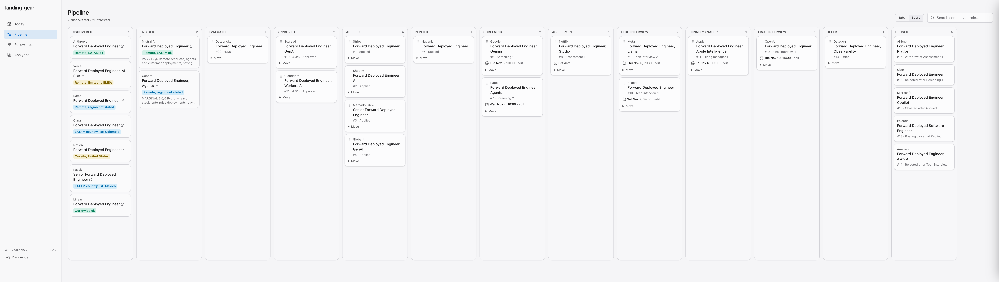
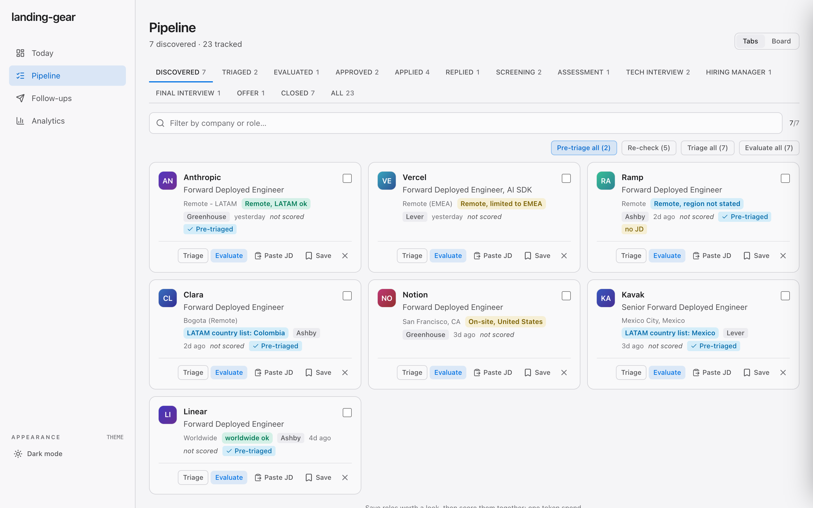
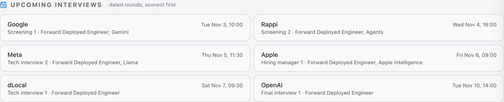
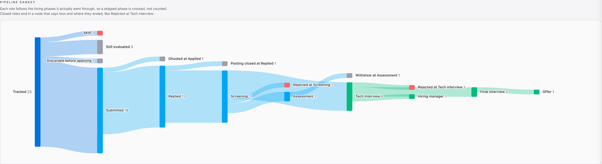

<h1 align="center">landing-gear</h1>

<p align="center"><b>git hired.</b></p>

<p align="center">
  Your next engineering role, on autopilot. Mostly.
</p>

<p align="center">
  
  
  
  
  
  
</p>

<p align="center">
  <picture>
    <source media="(prefers-color-scheme: dark)" srcset="docs/screenshots/board-dark.png">
    
  </picture>
</p>

<p align="center"><sub>Sample data: a fictional Forward Deployed Engineer search.</sub></p>

landing-gear finds the jobs, reads them before you do, and tracks every interview until you land. It runs on your machine, with your AI. Your CV never leaves the cockpit.

## Fewer tabs. Better jobs.

**Scans while you sleep.** Greenhouse, Lever, Ashby, Workday, Hacker News, Y Combinator and more, every morning. Zero tokens.

**Reads the fine print for free.** "Must reside in Ohio." "Pay: exposure." "I am looking for a job." Pre-triage reads the posting and quietly drops the ones that were never going to work. In English and in Spanish.

**Knows where you can work from.** Remote, LATAM ok. Remote, limited to EMEA. Doesn't say. Every posting gets a label before you click.

**Evaluates what's left.** A quick triage score, then a full report: fit, gaps, red flags, and what to say in the interview.

## Every round. Every outcome.

Applied, replied, screening, tech, hiring manager, final, offer. Drag a card to the next phase, set the interview date, and Today reminds you what's coming up. And when it ends, it remembers how: rejected, withdrew, ghosted. The funnel doesn't lie, even when recruiters do.

<table>
  <tr>
    <td width="50%">
      <picture>
        <source media="(prefers-color-scheme: dark)" srcset="docs/screenshots/discovered-dark.png">
        
      </picture>
      <br><b>Discovered</b><br>New postings, each with where you can work from and whether pre-triage passed it.
    </td>
    <td width="50%">
      <picture>
        <source media="(prefers-color-scheme: dark)" srcset="docs/screenshots/today-dark.png">
        
      </picture>
      <br><b>Upcoming interviews</b><br>Every dated round, soonest first, so nothing sneaks up on you.
    </td>
  </tr>
  <tr>
    <td colspan="2">
      <picture>
        <source media="(prefers-color-scheme: dark)" srcset="docs/screenshots/sankey-dark.png">
        
      </picture>
      <br><b>The real funnel</b><br>Phase by phase, with how each closed process ended.
    </td>
  </tr>
</table>

## Built for engineers.

Tuned for mobile, backend, full-stack and AI roles. No chatbot asking how you feel about your career. Just Claude Code, your terminal, and a web app that stays out of the way.

## Get started

**Fastest way: let your agent do it.** Clone the repo, open the folder in Claude Code (or Codex, Cursor, OpenCode...) and say:

> Read the README and set up landing-gear for me.

The agent follows [Set up (agent playbook)](#set-up-agent-playbook) below. The only things it asks you for are your CV and what you are looking for.

**By hand:**

```bash
git clone https://github.com/icarloscornejo/landing-gear.git
cd landing-gear
npm install
npm --prefix web ci
```

Open the folder in Claude Code and run `/landing-gear`. It asks for your CV, your target roles, pay and location, then writes your config. Start the dashboard with `npm run ui` (opens `http://127.0.0.1:3000`).

## Requirements

| Need | Notes |
|---|---|
| Node.js 22.13+ and `git` | Check with `node --version`. |
| An AI coding CLI, logged in | Claude Code is recommended. It does the triage and the full evaluations (the zero-token scan and the pre-triage need no AI). |
| Poppler (optional) | `pdftotext` and `pdfinfo`, only to verify generated CVs. |

## Set up (agent playbook)

Agent: run these yourself, in order. Ask the owner only for information about them and for confirmations. Never submit an application, send a message or edit anything outside this folder.

1. **Check requirements.** `node --version` must be 22.13 or newer, and `git` must exist. If not, tell the owner what to install and wait.
2. **Install.** From the repo root: `npm install`, then `npm --prefix web ci`.
3. **Check the install.** `node doctor.mjs --json`. It lists what is missing (`cv.md`, `config/profile.yml`, `modes/_profile.md`, `portals.yml`) and what still holds template text.
4. **Collect the owner's information.** Their CV (PDF, Word or pasted text) and answers to: target roles, monthly pay minimum and currency, country and city, timezone, whether they work only remote, and any deal-breakers.
5. **Write the config.** Follow "First Run, Onboarding" in `AGENTS.md`: create `cv.md` from their CV, then run `node onboard-write.mjs --answers -` with a JSON of their answers (`node onboard-write.mjs --help` shows every field). It writes `config/profile.yml` and `portals.yml` and never overwrites existing files. Then `node remember-cli.mjs <cli>` records which AI CLI you are.
6. **Verify.** `node doctor.mjs` again, then a first scan: `node scan.mjs --dry-run` (prints what it would add), then `node scan.mjs`.
7. **Start the dashboard.** `npm run ui` and tell the owner the address (`http://127.0.0.1:3000`).
8. **Report back** in plain words: what you configured, where the files are, and what the owner should check.

Personal files (`cv.md`, `config/`, `portals.yml`, `data/`, `reports/`, `jds/`) are ignored by git: a clone ships none of anyone's data, only templates.

## Configure your search

Everything that decides what you see lives in three files, created by the onboarding. Edit them any time:

| File | What to change |
|---|---|
| `portals.yml` | **The search itself.** `title_filter.positive` and `.negative` (titles that enter and titles that never do), `location_filter` (countries and cities allowed and blocked), `tracked_companies` (the boards the scan reads every day), `linkedin_post_queries` and `x_post_queries` (what the LinkedIn and X scripts search). |
| `config/profile.yml` | Who you are: contact, pay minimum, where you can work from, and the optional `pre_triage` rules (skip junior roles, blocked places). |
| `modes/_profile.md` | How evaluations judge fit: your target roles (archetypes), your framing, your negotiation scripts. |

To add a company, ask your agent "add Acme to my scan" or run `node discover-ats.mjs Acme` (a preview; `--write` saves it). `node audit-portals.mjs --summary` checks that every board still answers.

## Run it

| What | How |
|---|---|
| The dashboard | `npm run ui` (development, `http://127.0.0.1:3000`). For a steady run, `cd web && npm run build && npm start`. Options: `--port=3030`, `--no-open`. |
| The portal scan | The **Run scan now** button on Today, or `node scan.mjs`. While the dashboard is running it also scans by itself every day from 8:00 (turn that off with `LANDING_GEAR_NO_DAILY_SCAN=1`). |
| Triage and evaluation | The **Triage** and **Evaluate** buttons on each posting. They start your AI CLI in the background, up to 6 at a time, and you watch them in the Workers list. |
| LinkedIn and X posts | Once a day, paste a script in the browser console. LinkedIn: the card on Today has a **Copy script** button. X: `node web/src/lib/x-script.mjs` prints it (add `\| pbcopy` on macOS). Each script reads the queries in `portals.yml`, downloads a file to `~/Downloads`, and your agent turns the good posts into Discovered rows. |

## Keep it running

The daily scan only runs while the dashboard is running, so for "set it and forget it" run the dashboard as a service. These are templates: replace the paths, and check that your AI CLI (for example `claude`) is on the service's `PATH`, because services start with a minimal one.

**macOS (launchd).** Keep the repo outside `Desktop`, `Documents` and `Downloads`, for example `~/landing-gear`: macOS blocks background jobs from reading those folders and the job fails with "Operation not permitted". Save as `~/Library/LaunchAgents/com.landing-gear.web.plist`, then `launchctl bootstrap gui/$(id -u) ~/Library/LaunchAgents/com.landing-gear.web.plist`:

```xml
<?xml version="1.0" encoding="UTF-8"?>
<!DOCTYPE plist PUBLIC "-//Apple//DTD PLIST 1.0//EN" "http://www.apple.com/DTDs/PropertyList-1.0.dtd">
<plist version="1.0"><dict>
  <key>Label</key><string>com.landing-gear.web</string>
  <key>WorkingDirectory</key><string>/Users/YOU/landing-gear/web</string>
  <key>ProgramArguments</key><array><string>/opt/homebrew/bin/node</string><string>server.mjs</string><string>start</string></array>
  <key>EnvironmentVariables</key><dict><key>PATH</key><string>/opt/homebrew/bin:/usr/local/bin:/usr/bin:/bin</string></dict>
  <key>RunAtLoad</key><true/>
  <key>KeepAlive</key><true/>
</dict></plist>
```

**Linux (systemd user service).** Save as `~/.config/systemd/user/landing-gear.service`, then `systemctl --user enable --now landing-gear`:

```ini
[Unit]
Description=landing-gear dashboard
[Service]
WorkingDirectory=%h/landing-gear/web
ExecStart=/usr/bin/env node server.mjs start
Restart=always
Environment=PATH=%h/.local/bin:/usr/local/bin:/usr/bin:/bin
[Install]
WantedBy=default.target
```

**Windows.** Task Scheduler: a task "At log on" running `node server.mjs start` in the `web` folder. Or `npm i -g pm2`, then `pm2 start "node server.mjs start" --cwd web --name landing-gear` and `pm2 save`.

Run `npm run build` in `web/` once (and after each update) before the service starts.

## Online access (phone, another computer)

**The dashboard has no login on purpose: it listens on `127.0.0.1` only.** It shows your CV, tracker and reports, and it can start processes on your machine, so never put it on the open internet. If you want it on your phone or another computer, put it behind something that authenticates:

1. **Tailscale (simplest).** Install it on both devices and open the dashboard through the machine's tailnet name. Nothing is public.
2. **Cloudflare Tunnel with Cloudflare Access.** The tunnel alone is a public URL: add an Access policy that allows only your email before you share the link.

Either way the dashboard refuses any request whose `Host` it was not told about. Name the exact hostname in `LANDING_GEAR_WEB_ALLOWED_HOSTS` (for example `LANDING_GEAR_WEB_ALLOWED_HOSTS=my-machine.tailnet.ts.net`). When you set it, the launcher prints which address it binds and warns that it is reachable from your network: read that line, and keep your firewall closed to everyone else. A hosted copy on a server is not supported, because your data lives in local files.

## Your data stays on the ground.

Your CV, tracker, reports and notes live in files git ignores. Nothing is uploaded, and nothing is ever submitted for you.

---

<p align="center"><sub>Based on <a href="https://github.com/career-ops-hq/career-ops">career-ops</a> by Santiago Fernández de Valderrama. MIT licensed.</sub></p>
