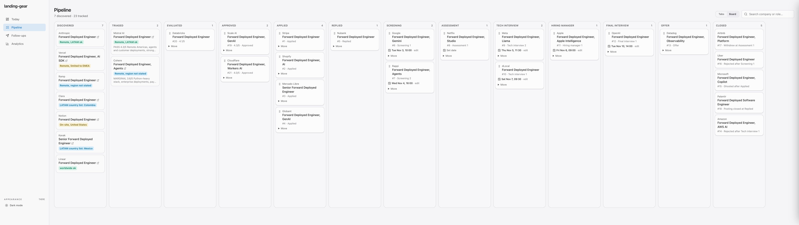
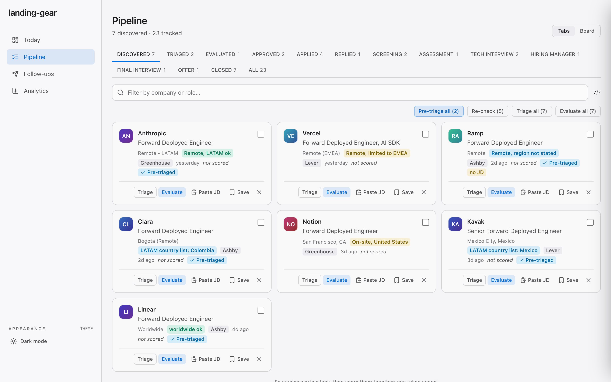
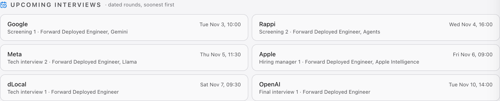
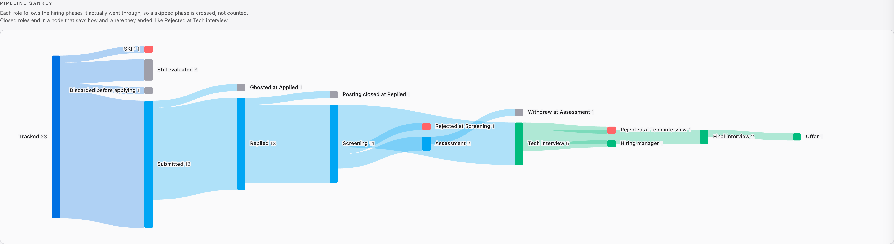

<h1 align="center">landing-gear</h1>

<p align="center"><b>git hired.</b></p>

<p align="center">
  Your next engineering role, on autopilot. Mostly.
</p>

<p align="center">
  
  
  
  
  
  
</p>

<p align="center">
  <picture>
    <source media="(prefers-color-scheme: dark)" srcset="docs/screenshots/board-dark.png">
    
  </picture>
</p>

<p align="center"><sub>Sample data: a fictional Forward Deployed Engineer search.</sub></p>

landing-gear finds the jobs, reads them before you do, and tracks every interview until you land. It runs on your machine, with your AI. Your CV never leaves the cockpit.

## Fewer tabs. Better jobs.

**Scans while you sleep.** Greenhouse, Lever, Ashby, Workday, Hacker News, Y Combinator and more, every morning. Zero tokens.

**Reads the fine print for free.** "Must reside in Ohio." "Pay: exposure." "I am looking for a job." Pre-triage reads the posting and quietly drops the ones that were never going to work. In English and in Spanish.

**Knows where you can work from.** Remote, LATAM ok. Remote, limited to EMEA. Doesn't say. Every posting gets a label before you click.

**Evaluates what's left.** A quick triage score, then a full report: fit, gaps, red flags, and what to say in the interview.

## Every round. Every outcome.

Applied, replied, screening, tech, hiring manager, final, offer. Drag a card to the next phase, set the interview date, and Today reminds you what's coming up. And when it ends, it remembers how: rejected, withdrew, ghosted. The funnel doesn't lie, even when recruiters do.

<table>
  <tr>
    <td width="50%">
      <picture>
        <source media="(prefers-color-scheme: dark)" srcset="docs/screenshots/discovered-dark.png">
        
      </picture>
      <br><b>Discovered</b><br>New postings, each with where you can work from and whether pre-triage passed it.
    </td>
    <td width="50%">
      <picture>
        <source media="(prefers-color-scheme: dark)" srcset="docs/screenshots/today-dark.png">
        
      </picture>
      <br><b>Upcoming interviews</b><br>Every dated round, soonest first, so nothing sneaks up on you.
    </td>
  </tr>
  <tr>
    <td colspan="2">
      <picture>
        <source media="(prefers-color-scheme: dark)" srcset="docs/screenshots/sankey-dark.png">
        
      </picture>
      <br><b>The real funnel</b><br>Phase by phase, with how each closed process ended.
    </td>
  </tr>
</table>

## Built for engineers.

Tuned for mobile, backend, full-stack and AI roles. No chatbot asking how you feel about your career. Just Claude Code, your terminal, and a web app that stays out of the way.

## Get started

```bash
git clone https://github.com/icarloscornejo/landing-gear.git
cd landing-gear && npm install
```

Open it in Claude Code and run `/landing-gear`. It walks you through your CV, profile and the companies to watch.

```bash
cd web && npm install && npm run dev
```

Requires Node.js 22.13+ and an AI coding CLI (Claude Code recommended).

## Your data stays on the ground.

Your CV, tracker, reports and notes live in files git ignores. Nothing is uploaded, and nothing is ever submitted for you.

---

<p align="center"><sub>Based on <a href="https://github.com/career-ops-hq/career-ops">career-ops</a> by Santiago Fernández de Valderrama. MIT licensed.</sub></p>
